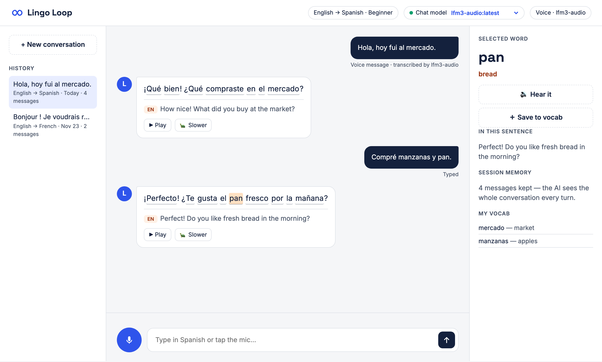
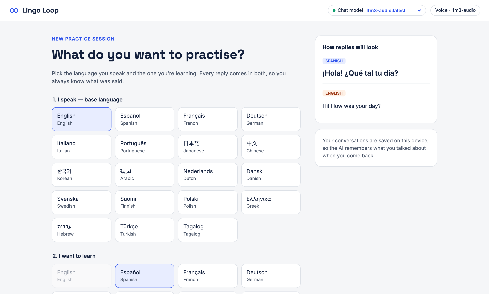

# Lingo Loop

Practice a language by chatting — by text or voice — with an AI that runs entirely on your machine.
Every reply comes in the language you're learning, with a translation into your own, and is read aloud.



## Features

- **19 languages** — any pair of English, Spanish, French, German, Italian, Portuguese, Japanese, Chinese, Korean, Arabic, Dutch, Danish, Swedish, Finnish, Polish, Greek, Hebrew, Turkish and Tagalog.
- **Voice or text** — speak into the mic (transcribed locally) or type; replies are spoken back, with a slower playback option.
- **Bilingual replies** — each answer in the target language plus a translation into your base language.
- **Tap-to-translate words** — tap any word in a reply to look it up, hear it, and save it to your vocab list.
- **Persistent conversations** — chats and vocab are stored in a local SQLite database; the AI sees the whole conversation every turn.
- **Pick your chat model** — use any installed Ollama model for chat; speech and transcription use `lfm3-audio`.
- **Fully local** — no accounts, no cloud APIs. Everything goes through [Ollama](https://ollama.com).



## Tech stack

| Part | Stack |
|---|---|
| `apps/server` | Rust, [axum](https://github.com/tokio-rs/axum), rusqlite (bundled SQLite), reqwest |
| `apps/web` | React 19, Vite, Playwright tests |
| Model | [lfm3-audio](https://ollama.com/library/lfm3-audio) via Ollama |

```
apps/
  server/   Rust API; also serves the built web app (apps/web/dist)
  web/      React + Vite frontend
docs/       Screenshots
```

## Getting started

### Prerequisites

- [Ollama](https://ollama.com) ≥ 0.40.12
- Rust (edition 2024)
- Node.js ≥ 20

### Install and run

```sh
ollama pull lfm3-audio

cd apps/web && npm install && npm run build && cd ../..
cargo run
```

Open <http://127.0.0.1:3000>.

### Frontend development

With the server running, start Vite for hot reload. It proxies `/api` to `127.0.0.1:3000`.

```sh
cd apps/web
npm run dev
```

## Configuration

Set these environment variables for `cargo run`:

| Variable | Default | Description |
|---|---|---|
| `OLLAMA_URL` | `http://localhost:11434` | Ollama base URL |
| `MODEL` | `lfm3-audio:latest` | Default chat model; always used for speech and transcription |
| `ADDR` | `127.0.0.1:3000` | Address the server listens on |
| `DB_PATH` | `apps/server/language-ai.db` | SQLite database file |
| `WEB_DIR` | `apps/web/dist` | Directory of static frontend files |

## API

| Endpoint | Body → Response | Ollama call |
|---|---|---|
| `GET /api/convos` | → conversations, most recent first | — |
| `POST /api/convos` | `{base, target, level, mode}` → conversation | — |
| `POST /api/chat` | `{convo, text, voice, model?}` → `{target, base}` | `/api/chat` ×2: reply in target language, then translate it |
| `POST /api/translate` | `{text, from, to, model?}` → `{text}` | `/api/chat` |
| `GET /api/vocab?lang=` | → `[{word, gloss}]` | — |
| `POST /api/vocab` | `{lang, word, gloss}` → 204 | — |
| `GET /api/models` | → `{default, models}` | `/api/tags` |
| `POST /api/transcribe` | 16 kHz mono WAV → `{text}` | `/v1/audio/transcriptions` |
| `POST /api/speak` | `{text, voice}` → 24 kHz WAV | `/v1/audio/speech` |

The server only accepts cross-origin requests from `localhost` / `127.0.0.1`, so other websites can't drive your Ollama through it.

## How it works

The browser records audio and resamples it to a 16 kHz WAV. The server then runs speech-to-text → chat → translate → text-to-speech as separate Ollama calls. The user's message is saved before the model is called, so it survives an Ollama failure.

**Why not one call?** Sending audio straight into chat (`input_audio`) gave empty replies, and the model has no structured output, so asking for a reply and translation together was unreliable.

**Why not rig?** rig's Ollama provider only covers chat and embeddings. lfm3-audio's audio features are only available through Ollama's OpenAI-style `/v1/audio/*` routes, so the server calls them directly with `reqwest`.

## Testing

```sh
cargo test                  # server + database
cd apps/web && npm test     # builds, then runs Playwright UI tests against a faked API
```

The UI tests intercept every request, so they need no running server or Ollama, and they never touch your database.
